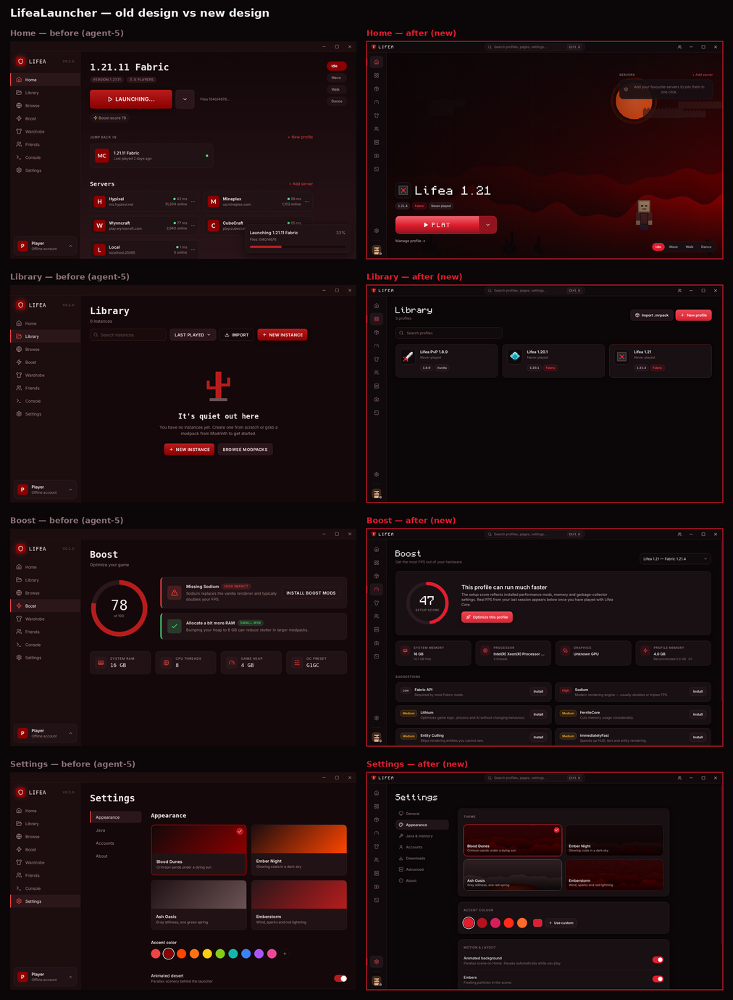

# LifeaLauncher

A fast, blood-red Minecraft Java launcher and client — Dawn-style launcher layout, Lunar-style in-game features.

- **Plays any version:** vanilla, Fabric, Quilt, Forge and NeoForge, from 1.8.9 to the latest release.
- **No Java setup:** downloads the exact Java each version needs (8, 17 or 21).
- **Modrinth built in:** installs pick the build for your version and loader and pull in required dependencies. Also
  update checks, `.mrpack` import/export, and one-click modpacks.
- **Boost:** "Optimize this profile" installs the version-correct performance pack (Sodium, Lithium, FerriteCore,
  Entity Culling, ImmediatelyFast, ModernFix, Dynamic FPS, More Culling). Real FPS from your sessions appears in the
  launcher.
- **Lifea Core mod (in game, Right Shift):**
  - HUD editor with FPS, CPS, keystrokes, ping, coordinates, armor, potions, waypoints and more;
  - zoom, freelook, toggle sprint, fullbright, custom crosshair;
  - Lifea capes.
- **Social:** friends, presence ("Playing on …"), DMs and cosmetics via the self-hostable [Lifea backend](server/README.md).
- **Accounts:** Microsoft login, plus offline accounts for singleplayer and LAN.

## Design

Old (agent-5) vs new. Per-page comparisons are in [`docs/design`](docs/design).



## Install

Download the installer for your OS from the latest [GitHub Release](https://github.com/nafehawan/lifealauncher/releases):
`.exe` (Windows x64/ARM64), `.dmg` (macOS universal), `.AppImage` (any Linux) or `.deb` (Debian/Ubuntu:
`sudo apt install ./LifeaLauncher-*.deb`). The launcher updates itself (Windows, macOS, AppImage).

Where things live:

| What | Where |
|---|---|
| Launcher settings, accounts, logs | Windows `%APPDATA%\LifeaLauncher`, macOS `~/Library/Application Support/LifeaLauncher`, Linux `~/.config/LifeaLauncher` |
| Profiles, game files, Java runtimes | `~/.lifea` (change it in Settings → Advanced) |

### Troubleshooting

- **"Wrong Java version"**: click *Use managed Java*, then launch again.
- **Antivirus removed native libraries**: add `~/.lifea` to its exclusions, then launch again.
- **"Graphics driver problem"**: install the latest driver from your GPU vendor (not Windows Update).
- **Anything else**: Console → *Upload to mclo.gs*, and include `logs/main.log` from the launcher folder.

## Develop

```bash
npm install
npm run dev          # Vite + Electron with hot reload
npm run check        # both TypeScript projects + ESLint + unit tests
npm run pack         # build an unpacked app in release/
LIFEA_E2E_EXECUTABLE=release/linux-unpacked/lifealauncher xvfb-run -a npx playwright test   # e2e on the packaged app
npm run dist:win     # installers (also dist:mac, dist:linux)
```

Layout:

```
src/shared     IPC contract, types, constants, zod schemas (used by every process)
src/main       Electron main: game engine (src/main/game), accounts, servers, social, IPC handlers, app:// protocol
src/preload    Sandboxed preload — whitelisted invoke/on bridge only
src/renderer   React UI (pages, components, stores)
mod/           lifea-core Fabric mod (Gradle)
server/        Lifea backend (Fastify)
test/ e2e/     Vitest unit tests (fixtures in test/fixtures) and Playwright tests against the real app
```

### Build configuration

| Env var (build time) | Purpose |
|---|---|
| `LIFEA_MSA_CLIENT_ID` | Azure app ID for Microsoft login. It must be approved by Mojang for the Minecraft API. Without it only offline accounts work. |
| `LIFEA_BACKEND_URL` | Default Lifea backend for friends/cosmetics (users can override it in Settings). |
| `CSC_LINK`, `CSC_KEY_PASSWORD` | Code-signing certificate for electron-builder (Windows/macOS). |

Releases: run the **Release** workflow from the Actions tab (it tags `v<version>`), or push a `v*` tag. `.github/workflows/release.yml` builds the mod, bundles it, and publishes the installers (signed when `CSC_LINK` is set)
to the GitHub Release. **Never commit installers to git.**

### Assets

`scripts/gen_assets.py` generates the pixel-art scenes and sprites. They ship as lossless WebP: scenes are 61 % smaller
than the old PNGs, and the character frames are 4-frame sprite sheets. `scripts/gen_cosmetics.py` generates the
original cosmetic textures used by the backend.

## Credits

- [Modrinth](https://modrinth.com) API for mods and modpacks.
- [Monocraft](https://github.com/IdreesInc/Monocraft) font (OFL).
- [skinview3d](https://github.com/bs-community/skinview3d).
- Not affiliated with Mojang or Microsoft. Minecraft is a trademark of Mojang AB.

MIT licensed.
